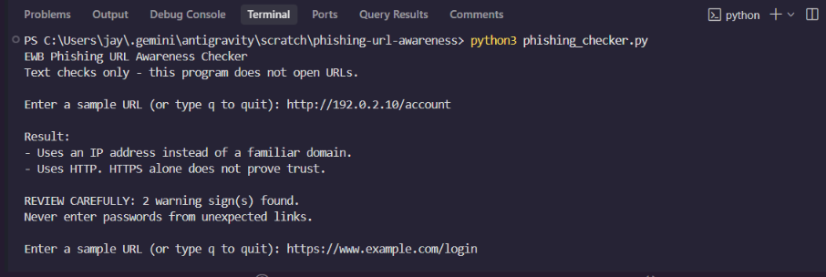
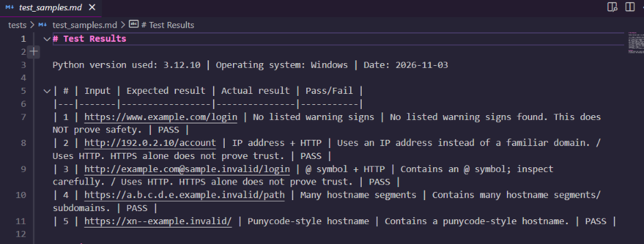

# EWB Phishing URL Awareness Checker

## Overview
Phishing is a deceptive technique where attackers use fraudulent links to trick victims into sharing sensitive credentials, financial details, or personal data. This tool is a lightweight command-line educational utility that inspects URL text for visible indicators of suspicious structure. It operates purely on raw text and never opens, visits, or scans the submitted links.

## Features
- Detects an @ symbol in the URL
- Flags unusually long URLs (over 100 characters)
- Flags IP-address hostnames
- Flags many hostname segments (5 or more)
- Flags punycode-style hostnames (xn--)
- Flags the HTTP scheme
- Continuous checking loop with quit commands (q, quit, exit)
- Review Carefully warning summary when suspicious indicators are detected

## Requirements
Python 3.10 or later. No extra packages.

## How to Run
Windows: python phishing_checker.py
Mac/Linux: python3 phishing_checker.py

## Example Output
```text
EWB Phishing URL Awareness Checker
Text checks only - this program does not open URLs.

Enter a sample URL (or type q to quit): http://192.0.2.10/account

Result:
- Uses an IP address instead of a familiar domain.
- Uses HTTP. HTTPS alone does not prove trust.

REVIEW CAREFULLY: 2 warning sign(s) found.
Never enter passwords from unexpected links.
```

## Testing
| # | Input | Expected | Actual | Result |
|---|-------|----------|--------|--------|
| 1 | https://www.example.com/login | No warning signs | No listed warning signs found. This does NOT prove safety. | PASS |
| 2 | http://192.0.2.10/account | IP address + HTTP | Uses an IP address instead of a familiar domain. / Uses HTTP. HTTPS alone does not prove trust. | PASS |
| 3 | http://example.com@sample.invalid/login | @ symbol + HTTP | Contains an @ symbol; inspect carefully. / Uses HTTP. HTTPS alone does not prove trust. | PASS |
| 4 | https://a.b.c.d.e.example.invalid/path | Many hostname segments | Contains many hostname segments/subdomains. | PASS |
| 5 | https://xn--example.invalid/ | Punycode-style hostname | Contains a punycode-style hostname. | PASS |

Full table is in tests/test_samples.md.

## Screenshots



## Improvements
1. Loop with quit - Added a continuous `while True` loop so users can inspect multiple URLs without restarting the program, supporting `q`, `quit`, and `exit` commands. Tested with single and batch runs.
2. Review carefully summary - Added an `INFO_MESSAGES` tuple and `has_warnings()` helper function to count and display a clear `REVIEW CAREFULLY: X warning sign(s) found.` summary when genuine warnings are triggered. Tested across all sample inputs.

## Limitations
This is an educational tool. It only reads URL text. It does not visit URLs, scan for malware or prove that a URL is safe. No warning signs found does NOT mean a URL is safe.

## Ethical Use
Use sample strings only. Do not collect credentials. Do not use this project to deceive anyone or to test websites without permission.

## Author
Student, Cybersecurity Mini Project, EWB Courses

